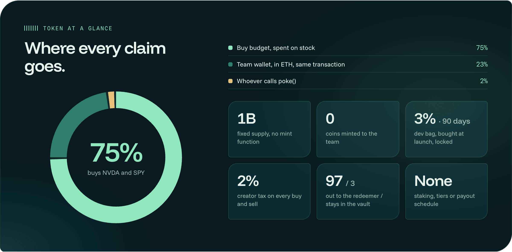
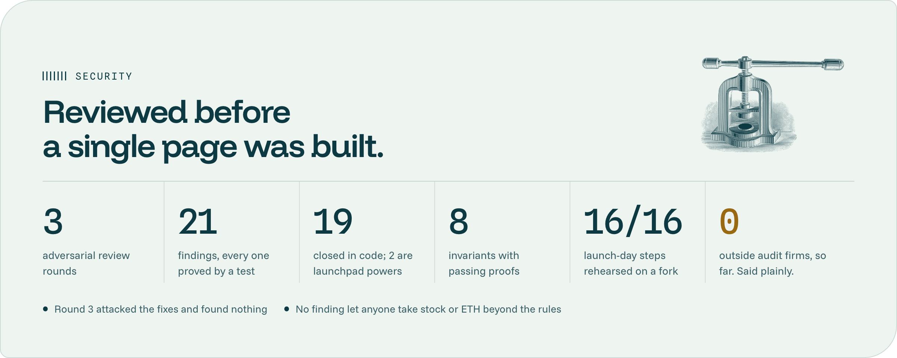

 

**[Website](https://hybirdex.app)** · **[App](https://app.hybirdex.app)** · **[Docs](https://hybirdex.app/docs)** · **[X](https://x.com/hybirdex)**

---

## What is Hybirdex

A coin with a trading fee collects real money every day. On most coins it lands in a private wallet, holders are told it pays for buybacks they cannot check, and when the volume fades the coin is worth whatever the last buyer paid.

Hybirdex points that fee at a vault on Robinhood Chain with no owner and no withdraw button. The vault can only buy **NVDA** and **SPY** stock tokens, and it never sells them. A holder who wants out can sell on the market like any coin, or burn **$HYBRID** and take a proportional slice of the stock in the same transaction.

Most coins die holding nothing. This one is built to die holding stock.

  

- **The fee is the product.** About 2.7% of taxed volume reaches the vault; 75% of every claim buys stock.
- **Nothing to trust.** No owner, no withdraw function, no upgrade path, no setter.
- **Leaving pays the stayers.** Every redemption leaves 3% behind for the coins still outstanding.
- **Works without visitors.** The vault fills wherever the coin trades; the site only shows what it did.
- **Every fact is checkable.** Each purchase, claim and redemption is a row on chain with its transaction.

---

## Features

| Feature | What it does |
|---|---|
| **Ownerless vault** | Fee recipient of $HYBRID from the first block; nobody, the team included, can withdraw or reconfigure it |
| **Fixed split** | Every claim: 75% buys stock, 23% to the team in ETH, 2% to whoever calls `poke()` |
| **Guarded buy engine** | 0.005 to 0.25 ETH per buy, 10 minutes apart, NVDA and SPY in turn, within 1% of the pool and 2% of the feeds |
| **Market-hours aware** | No buys on Saturday, Sunday or the first hour of Monday (UTC); the budget waits |
| **Burn and take** | `redeem()` pays amount ÷ total supply × balance × 97% of each asset |
| **Total-supply share** | Parking coins in a pool cannot inflate anyone's slice |
| **Aged ETH** | ETH the vault could not spend joins redemptions within 30 days of its claim |
| **One switch** | A guardian can pause buys and nothing else; it cannot touch assets or stop a redemption |
| **Open caller** | Anyone can run the vault: `poke()` pays a 2% tip, `buy()` needs no permission |
| **Small, slow dev bag** | 3% bought at launch, locked 90 days, same claim per coin |
| **Public ledger** | Purchases, claims and redemptions kept in vault state, shown on Proof |
| **Own-volume meter** | The share of volume from our own wallets, listed by address, on the front page |
| **Trade page** | $HYBRID, NVDA and SPY with 0% fee from us |
| **Read API** | Seven CORS-open routes so trackers can show "coin + what is inside it" |

---

## Core Mechanics

  

### Price and book

Book per coin is what one coin would receive from `redeem()` now. Above book is the normal state. Below book, buying on the market and burning returns more stock than the coins cost; each burn removes supply and leaves 3% behind, so the gap closes from both sides. It is a backstop under the price, far below it in good times, and it matters most on the day a coin is dying.

---

## The Product

The landing page and the app are public on Robinhood Chain, with the vault at a real zero until the coin launches.

  

  

| Page | What a visitor can do |
|---|---|
| **Vault** | See NVDA and SPY held, what 1,000,000 coins take out, price / book and the next purchase, without a wallet |
| **Take** | Burn $HYBRID and receive the stock, with selling and taking compared side by side |
| **Trade** | Buy or sell $HYBRID, NVDA and SPY on their own venues, 0% fee from us |
| **Proof** | Read every purchase, claim and redemption, the own-volume meter and the contract's facts |

---

## Token at a Glance

  

<b>Full token table</b>

 

| | |
|---|---|
| Ticker | $HYBRID |
| Chain | Robinhood Chain (EVM, chain id 4663) |
| Supply | 1,000,000,000, fixed, no mint |
| Team allocation minted | 0 |
| Dev bag | 30,000,000 (3%), bought in the launch transaction, locked 90 days |
| Creator tax | 2% on every buy and sell |
| Fee recipient | the vault contract |
| Exit | 97% of the slice out, 3% stays in the vault |
| Staking, tiers, payouts | none, on purpose |

---

## Security

  

- Three rounds of adversarial review: 21 findings, **19 closed in code**, 2 stated as launchpad powers. Round 3 found nothing.
- Eight invariants proved, including: no path moves stock out except `redeem()`, and `redeem()` never pays more than a fair slice.
- **No outside audit firm has reviewed the contracts.**

### Powers we do not control

- The stock tokens' issuer can pause them, block an address, burn a balance and upgrade the contract.
- The launchpad's owner can redirect future fees after a 3-day timelock; stock already in the vault stays out of reach.
- About 8% of supply ends in the launchpad's locker at graduation and can never redeem.

---

## Tech Stack

| Layer | Choice |
|---|---|
| Contracts | Solidity 0.8.28, Foundry, fork-tested against the live launchpad |
| Chain | Robinhood Chain |
| Venues | launchpad curve, then a Uniswap v4 pool for the coin; Uniswap v3 pools for NVDA and SPY |
| Price references | pool 30-minute mean plus NVDA, SPY and ETH / USD feeds |
| Web | Next.js 16.4, React 19.3, viem, WebGL2 |
| Hosting | non-root containers behind a TLS proxy |

---

## Roadmap

  

---

## ⚠️ Scam Warning

- **$HYBRID does not exist yet.** Any address posted before launch day is not ours.
- The contract address will be posted from [@hybirdex](https://x.com/hybirdex) and shown on [hybirdex.app](https://hybirdex.app). Nowhere else.
- There is **no presale, no allocation and no whitelist.** Anyone offering one in a DM is not us.
- We never ask for a seed phrase, a private key or a signature outside the app's own transactions.

---

## Reference Links

| Resource | Link |
|---|---|
| Website | [hybirdex.app](https://hybirdex.app) |
| App | [app.hybirdex.app](https://app.hybirdex.app) |
| Docs | [hybirdex.app/docs](https://hybirdex.app/docs) |
| X | [@hybirdex](https://x.com/hybirdex) |
| GitHub | [github.com/hybirdex](https://github.com/hybirdex) |

---

Hybirdex is an experimental on-chain product. Nothing here is financial, investment, legal or tax advice. $HYBRID is a memecoin; its price can fall to zero and nothing here promises it any value. The stock tokens are issued by a third party, follow a share's price without being the share, carry no ownership or vote, and are not offered in the United States and some other countries. Smart contracts can contain errors a review did not find, and an ownerless vault cannot be repaired after the fact. Hybirdex is not affiliated with NVIDIA, the S&P 500 ETF's sponsor, Robinhood or the launchpad.

