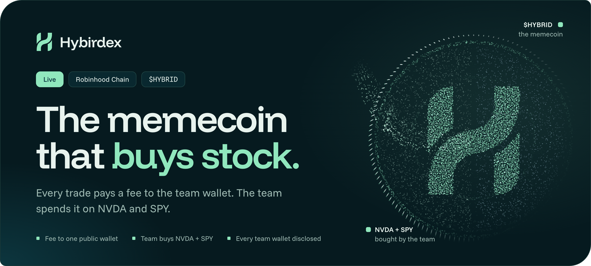
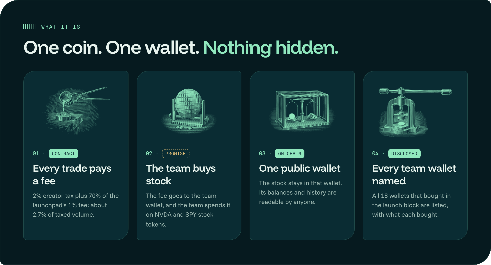
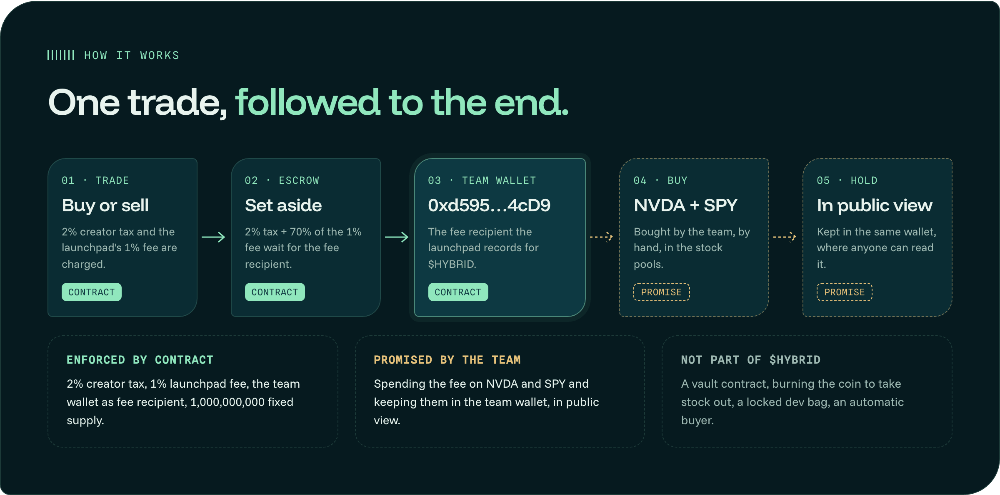
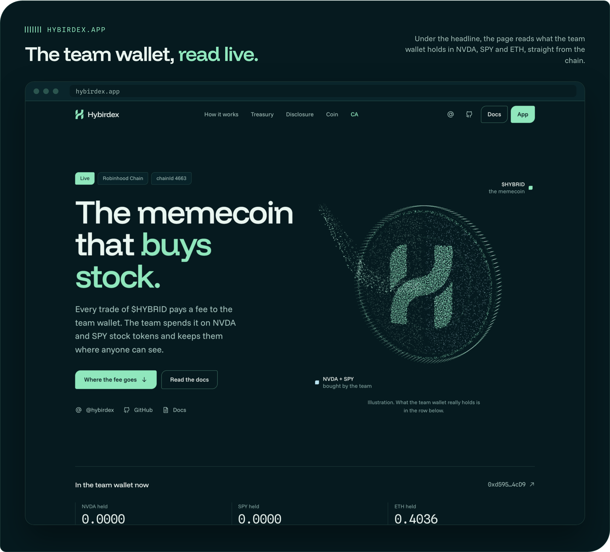
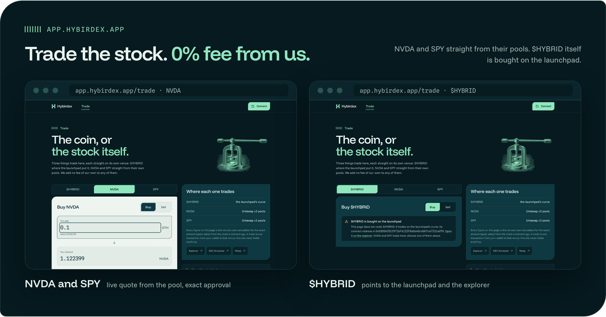
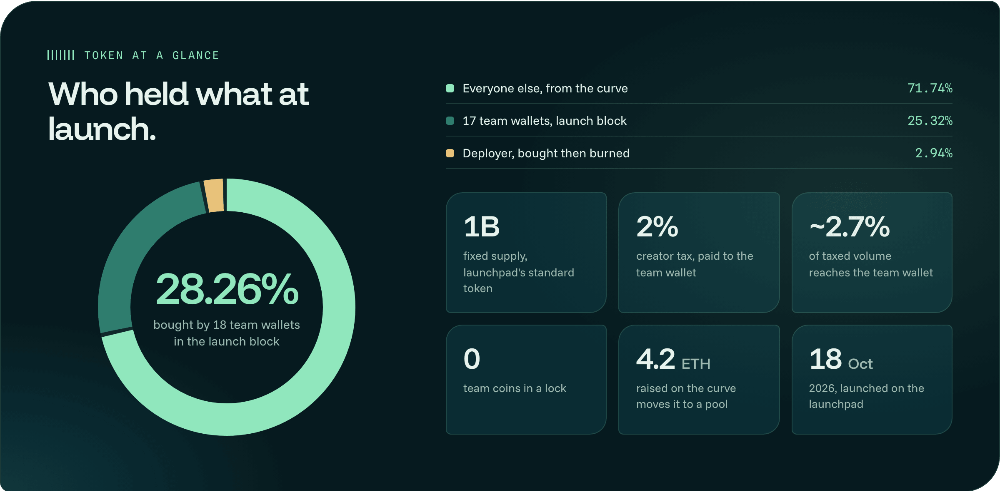
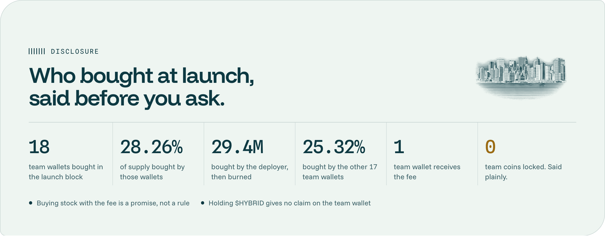
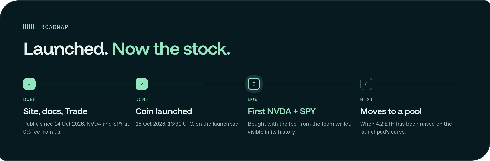

 

**[Website](https://hybirdex.app)** · **[App](https://app.hybirdex.app)** · **[Docs](https://hybirdex.app/docs)** · **[X](https://x.com/hybirdex)**

**CA:** `0x0305Af012971bF4122FBa0e40ceb07c47231ad70`

---

## What is Hybirdex

$HYBRID is a memecoin on Robinhood Chain, launched on the launchpad's bonding curve on 18 October 2026. Every buy and sell pays a fee, and the launchpad pays that fee to one wallet: the team wallet.

The team has committed to spend the fee on two stock tokens, **NVDA** and **SPY**, and to keep what it buys in that same wallet, where anyone can read it. The wallet is public, so the promise can be checked. It is still a promise: no contract enforces it.

  

- **One fee, one wallet.** About 2.7% of taxed volume reaches the team wallet.
- **Stock bought in the open.** Every NVDA or SPY purchase is a swap from that wallet, visible in its history.
- **Read live.** The landing page shows what the team wallet holds, straight from the chain.
- **Nothing hidden about launch.** All 18 team wallets that bought in the launch block are listed.

---

## Features

| Feature | What it does |
|---|---|
| **Live team wallet** | The landing page reads the team wallet's NVDA, SPY and ETH balances from the chain while the page is open |
| **Enforced vs promised** | Every step of the fee's path is labelled as enforced by the launchpad's contract or promised by the team |
| **Fee calculator** | Enter a day of volume and see the fee the team wallet receives: 2% creator tax plus 0.7% launchpad share |
| **Full launch disclosure** | The 18 team wallets, what each bought in the launch block, and the deployer's burn |
| **Trade page** | NVDA and SPY bought and sold straight from their pools, with 0% fee from us |
| **Exact approvals** | A sale approves only the amount being sold, never an unlimited allowance |
| **Read API** | Public routes for any wallet's balances, so trackers can show the team wallet too |
| **Docs** | Fee, team wallet, launch, Trade page, stock tokens, risks and every address on one page |

---

## How it works

  

| Part | Held by | What it covers |
|---|---|---|
| The fee | **Launchpad's contract** | 2% creator tax, 1% launchpad fee (70% of it to the fee recipient), the team wallet as fee recipient, a fixed supply of 1,000,000,000 |
| The stock | **Team promise** | Spending the fee on NVDA and SPY and keeping them in the team wallet, in public view |
| Not included | Nobody | A vault contract, burning the coin to take stock out, a locked dev bag, an automatic buyer |

> Holding $HYBRID gives no claim on the stock in the team wallet. There is no redeem, no burn-to-take and no payout.

---

## The Product

  

  

| Surface | What a visitor can do |
|---|---|
| **hybirdex.app** | Read where the fee goes, check the team wallet live, see every team wallet from the launch |
| **hybirdex.app/docs** | Read the full rules, risks and addresses |
| **app.hybirdex.app** | Trade NVDA and SPY at 0% fee from us; find where $HYBRID itself trades |

---

## Token at a Glance

  

<b>Full token table</b>

 

| | |
|---|---|
| Ticker | $HYBRID |
| Contract address | `0x0305Af012971bF4122FBa0e40ceb07c47231ad70` |
| Chain | Robinhood Chain (EVM, chain id 4663) |
| Supply | 1,000,000,000, fixed, the launchpad's standard token |
| Launch | 18 October 2026, 13:31 UTC, on the launchpad's bonding curve |
| Moves to a pool | once 4.2 ETH has been raised on the curve |
| Creator tax | 2% on every buy and sell, paid to the team wallet |
| Launchpad fee | 1%, of which 70% is paid to the team wallet |
| Fee recipient | team wallet `0xd595c51ccdE4c09e92fa9593501D475d2DC84cD9` |
| Locked team coins | none |

---

## Disclosure

  

<b>The 18 team wallets, with the coins each bought in the launch block</b>

 

| # | Wallet | Bought |
|---|---|---|
| 01 | [`0xd595c51ccdE4c09e92fa9593501D475d2DC84cD9`](https://robin.etherscan.io/address/0xd595c51ccdE4c09e92fa9593501D475d2DC84cD9) | 29,411,765 (deployer, burned) |
| 02 | [`0x05493726700eabD3fEad5f1D5FD1240e9c7B023A`](https://robin.etherscan.io/address/0x05493726700eabD3fEad5f1D5FD1240e9c7B023A) | 20,798,629 |
| 03 | [`0x67f13C476E70e01491f182bBD21fb2Cbe85123b7`](https://robin.etherscan.io/address/0x67f13C476E70e01491f182bBD21fb2Cbe85123b7) | 20,625,780 |
| 04 | [`0x5B4C10e062E573FAa707B380477CC2aAC4AC1ae1`](https://robin.etherscan.io/address/0x5B4C10e062E573FAa707B380477CC2aAC4AC1ae1) | 18,806,988 |
| 05 | [`0x2ed0a6Dd1706143ccc41dc47AaA70F17597C74F3`](https://robin.etherscan.io/address/0x2ed0a6Dd1706143ccc41dc47AaA70F17597C74F3) | 17,878,305 |
| 06 | [`0xEFa0420354127901CF59Bef9A085d35ba126FF4e`](https://robin.etherscan.io/address/0xEFa0420354127901CF59Bef9A085d35ba126FF4e) | 16,497,898 |
| 07 | [`0x3d38DA89BC407400F6f706a559eA55aEb1E879e2`](https://robin.etherscan.io/address/0x3d38DA89BC407400F6f706a559eA55aEb1E879e2) | 16,234,649 |
| 08 | [`0xd4495994513b1cFB74dB0592E536EB2dd25E104b`](https://robin.etherscan.io/address/0xd4495994513b1cFB74dB0592E536EB2dd25E104b) | 15,888,143 |
| 09 | [`0xCaFAdaB5CbCEF51d55fE434ceB812AE045e38cff`](https://robin.etherscan.io/address/0xCaFAdaB5CbCEF51d55fE434ceB812AE045e38cff) | 15,626,045 |
| 10 | [`0xB534D687c85419BA8659E02882Ea0882a695E663`](https://robin.etherscan.io/address/0xB534D687c85419BA8659E02882Ea0882a695E663) | 14,954,729 |
| 11 | [`0x542Fbe7E2177948fd0D59174A0ce021D0c526CF7`](https://robin.etherscan.io/address/0x542Fbe7E2177948fd0D59174A0ce021D0c526CF7) | 13,132,612 |
| 12 | [`0x4cB676bB0443fE12342001640468A9a809efAd9a`](https://robin.etherscan.io/address/0x4cB676bB0443fE12342001640468A9a809efAd9a) | 12,683,593 |
| 13 | [`0xf9B0Ed7197790Db3921e3bE61425bC3C84eb2906`](https://robin.etherscan.io/address/0xf9B0Ed7197790Db3921e3bE61425bC3C84eb2906) | 12,591,296 |
| 14 | [`0x2061D6318299b1D59AdB994e17E92ea9E2C4d17e`](https://robin.etherscan.io/address/0x2061D6318299b1D59AdB994e17E92ea9E2C4d17e) | 12,028,597 |
| 15 | [`0xDfF5099Cf976B12c3bFE6a8bD7CB554952633a2a`](https://robin.etherscan.io/address/0xDfF5099Cf976B12c3bFE6a8bD7CB554952633a2a) | 11,793,820 |
| 16 | [`0x0B724186A36Bcb73Eb09Eca7a8d77880D9D8c48A`](https://robin.etherscan.io/address/0x0B724186A36Bcb73Eb09Eca7a8d77880D9D8c48A) | 11,697,441 |
| 17 | [`0x72000AcDd69a16b7D1c61EFf3367c1058eDEC863`](https://robin.etherscan.io/address/0x72000AcDd69a16b7D1c61EFf3367c1058eDEC863) | 11,148,504 |
| 18 | [`0x8069543Cf25a4a3c3Eb1b2fd016fb052A02A4649`](https://robin.etherscan.io/address/0x8069543Cf25a4a3c3Eb1b2fd016fb052A02A4649) | 10,829,736 |

These are amounts bought in the launch block (block 91,806,505), not what each wallet holds today.

### Risks, in plain words

- The fee goes to a wallet the team controls. The team can spend it on anything. Buying stock is a promise, not a rule.
- The team holds a large share of supply through the wallets above and can sell it at any time.
- Holding $HYBRID gives no claim on the stock the team buys.
- The launchpad's owner can redirect the coin's fee recipient after a 3-day timelock.
- The stock tokens are issued by a third party. They follow a share's price, they are not the share, and their issuer can pause them or block an address.
- $HYBRID is a memecoin. Its price can fall to zero.

---

## Tech Stack

| Layer | Choice |
|---|---|
| Coin | the launchpad's standard token, fixed supply; no custom contract of ours is in use |
| Chain | Robinhood Chain |
| Venues | launchpad bonding curve for $HYBRID; Uniswap v3 pools for NVDA and SPY |
| Web | Next.js 16.4, React 19.3, viem, WebGL2 |
| Data | every figure read from the chain per request; no database |
| Hosting | non-root containers behind a TLS proxy |

---

## Roadmap

  

---

## ⚠️ Scam Warning

- The only $HYBRID is `0x0305Af012971bF4122FBa0e40ceb07c47231ad70`. Copies with the same name are not ours.
- The address is posted from [@hybirdex](https://x.com/hybirdex) and shown on [hybirdex.app](https://hybirdex.app). Nowhere else.
- There is **no presale, no allocation and no whitelist.** Anyone offering one in a DM is not us.
- We never ask for a seed phrase, a private key or a signature outside the app's own transactions.

---

## Reference Links

| Resource | Link |
|---|---|
| Website | [hybirdex.app](https://hybirdex.app) |
| App | [app.hybirdex.app](https://app.hybirdex.app) |
| Docs | [hybirdex.app/docs](https://hybirdex.app/docs) |
| Token on the explorer | [0x0305…ad70](https://robin.etherscan.io/token/0x0305Af012971bF4122FBa0e40ceb07c47231ad70) |
| Team wallet on the explorer | [0xd595…4cD9](https://robin.etherscan.io/address/0xd595c51ccdE4c09e92fa9593501D475d2DC84cD9) |
| X | [@hybirdex](https://x.com/hybirdex) |
| GitHub | [github.com/hybirdex](https://github.com/hybirdex) |

---

Hybirdex is an experimental project. Nothing here is financial, investment, legal or tax advice. $HYBRID is a memecoin; its price can fall to zero and nothing here promises it any value. The coin's fee is paid to a wallet the team controls, and spending it on NVDA and SPY is the team's commitment, not enforced by any contract. Holding $HYBRID gives no claim on anything the team wallet holds. The stock tokens are issued by a third party, follow a share's price without being the share, carry no ownership or vote, and are not offered in the United States and some other countries. Hybirdex is not affiliated with NVIDIA, the S&P 500 ETF's sponsor, Robinhood or the launchpad.

